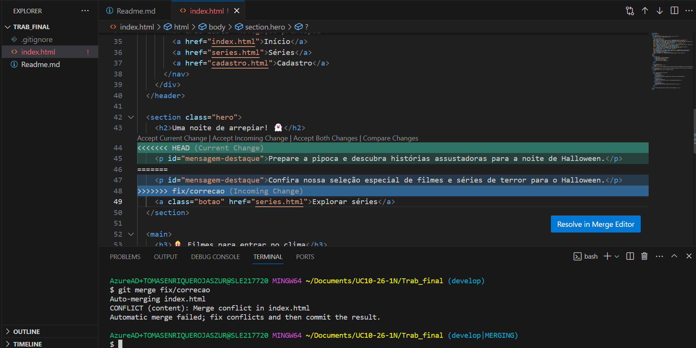

# 🎃 Portal Halloween — Filmes e Séries de Terror

## Sobre o projeto

O **Portal Halloween** é um site desenvolvido como trabalho final de Git e GitHub. O objetivo é apresentar sugestões de filmes e séries de terror em um tema visual inspirado no Halloween e demonstrar o uso do controle de versão durante o desenvolvimento.

O portal possui uma página inicial com sugestões fictícias de filmes, uma página com indicações de séries e uma página de cadastro demonstrativo.


## Objetivos

- Criar páginas HTML com navegação entre elas.
- Organizar o projeto usando Git e GitHub.
- Trabalhar com branches para separar funcionalidades e correções.
- Praticar commits, merges e Pull Requests.
- Simular e resolver um conflito de merge.
- Identificar versões do projeto usando tags e releases.

## Tecnologias e ferramentas

- **HTML5:** estrutura das páginas.
- **CSS:** estilos visuais incorporados às páginas HTML.
- **JavaScript:** comportamento demonstrativo do formulário de cadastro.
- **Git:** controle de versão local.
- **GitHub:** hospedagem do repositório remoto, Pull Requests, tags e releases.
- **Visual Studio Code:** edição dos arquivos.

## Estrutura dos arquivos

```text
Trab_final/
├── index.html
├── series.html
├── cadastro.html
├── Readme.md
├── imagens/
|   └── conflito-index.png
└── .gitignore
```

- `index.html`: página inicial do Portal Halloween, com apresentação e sugestões fictícias de filmes.
- `series.html`: página com sugestões de séries de terror e suspense.
- `cadastro.html`: formulário demonstrativo para registrar preferências de entretenimento.
- `Readme.md`: documentação do projeto.
- `.gitignore`: define arquivos locais e temporários que não precisam ser versionados.
- `imagens/`: contem a imagem tomada durante a apresentação do conflito local mediante o merge enter duas branchs

## Como abrir o portal

Não é necessário instalar dependências ou executar um servidor.

1. Baixe ou clone o repositório para o computador.
2. Abra a pasta `Trab_final`.
3. Dê dois cliques no arquivo `index.html` ou abra-o em um navegador.
4. Use o menu do site para acessar as páginas **Início**, **Séries** e **Cadastro**.
5. Na página de cadastro, teste os campos obrigatórios e o envio demonstrativo do formulário.

Para testar localmente, os arquivos `index.html`, `series.html` e `cadastro.html` devem permanecer na mesma pasta, pois os links de navegação apontam diretamente para esses arquivos.

## Organização das branches

As branches foram utilizadas para separar a versão principal, a integração das funcionalidades e o trabalho específico de cada etapa.

- `main`: branch principal, usada para manter a versão final e publicada do portal.
- `develop`: branch de integração, usada para reunir as funcionalidades e a correção antes de enviá-las para `main`.
- `feature/series`: branch criada para desenvolver a página `series.html`.
- `feature/cadastro`: branch criada para desenvolver a página `cadastro.html`.
- `fix/correcao`: branch usada para alterar o texto de destaque da página inicial e praticar a resolução de conflito.

## Estratégia de Pull Requests e resolução de conflito

As funcionalidades foram desenvolvidas em branches separadas e integradas por Pull Requests, permitindo revisar as alterações antes de incorporá-las à branch de destino.

Fluxo de integração utilizado:

1. `feature/series` → `develop`
2. `feature/cadastro` → `develop`
3. `develop` → `main`

A branch `fix/correcao` foi integrada localmente à `develop`. Durante essa etapa, o mesmo parágrafo de `index.html` foi alterado de maneiras diferentes em duas branches, provocando um conflito de merge. O conflito foi analisado e resolvido manualmente, removendo as marcações do Git e mantendo uma versão final do texto. Depois da resolução, o arquivo foi testado novamente no navegador.

## Captura de tela: conflito no `index.html`

A imagem abaixo mostrar o conflito local encontrado no arquivo `index.html` durante a atividade de merge.




## Histórico de versões

| Versão | Descrição |
|---|---|
| `v0.1.0` | Versão inicial do portal, com `index.html`, `Readme.md` e `.gitignore`, antes da inclusão das páginas de funcionalidades. |
| `v1.0.0` | Portal completo, com as páginas inicial, séries e cadastro demonstrativo, após a integração das funcionalidades e a resolução do conflito. |

